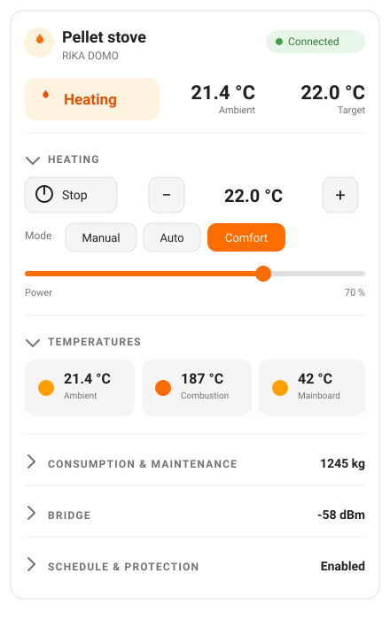

# Open Firenet Card


[](https://github.com/hacs/integration)
[](LICENSE)

**English** · [Français](docs/fr/README.md)

A Lovelace card for the Home Assistant integration
[open-firenet-ha](https://github.com/openfirenet/open-firenet-ha): it shows the
state of a RIKA pellet stove driven by the
[Open Firenet](https://github.com/openfirenet/open-firenet) bridge and,
optionally, lets you control it.

A single card gathers the stove status, temperatures, consumption, maintenance,
MultiAir fans, mechanics and the bridge.

<p align="center">
  
</p>

*Schematic illustration, not a screenshot: the card follows your Home Assistant
theme and language.*

## Features

- **Status at a glance**: translated stove state (heating, standby, cleaning…),
  animated flame, ambient temperature and target temperature.
- **Collapsible sections**: the essential sections (Heating, Temperatures,
  Consumption) are expanded on load; click a section header to expand or collapse
  it. A collapsed section keeps its key value in the header.
- **Click for details**: click a value (temperatures, consumption, mechanics,
  bridge) or the status to open Home Assistant's more-info dialog for the
  matching entity.
- **Coloured icons**: each domain has its own accent (fire in orange,
  temperatures in amber, mechanics in blue, link in green…), using Home
  Assistant theme variables so it follows the selected theme.
- **Controls** (can be disabled): on/off, target ±, mode (Manual / Auto /
  Comfort), heating power, MultiAir fans and their trims.
- **Auto-discovery**: from a single anchor entity, the card finds every entity
  of the same device. No entity list to fill in.
- **Robust**: missing entities (model without MultiAir, option not enabled,
  older firmware) are simply hidden.
- **Visual editor**: configure the entity, sections and controls from the UI,
  without writing YAML.

## Installation

See the detailed guide: [`docs/installation.md`](docs/installation.md).

### Via HACS (recommended)

1. HACS → **Dashboard** → ⋮ → **Custom repositories**.
2. Add `https://github.com/openfirenet/open-firenet-card` with category
   **Lovelace / Dashboard**.
3. Search for **Open Firenet Card** and install it.
4. The resource is added automatically. Otherwise, add it manually:
   `/hacsfiles/open-firenet-card/open-firenet-card.js`, type **JavaScript module**.

### Manual installation

1. Copy `dist/open-firenet-card.js` into `<config>/www/`.
2. Settings → **Dashboards** → ⋮ → **Resources** → **Add**:
   URL `/local/open-firenet-card.js`, type **JavaScript module**.
3. Reload the page (Ctrl+F5).

## Adding to a dashboard

### Visual UI editor (recommended)

1. Open your dashboard and click ⋮ → **Edit dashboard**.
2. Click **+ ADD CARD**.
3. Scroll to the **Custom** section and select **Open Firenet Card**.
4. Pick the anchor entity (default `climate.open_firenet`) and set the options
   you want (title, sections, controls…).
5. Click **SAVE**.

### YAML configuration

Alternatively, add the card directly in the dashboard's YAML editor:

```yaml
type: custom:open-firenet-card
entity: climate.open_firenet
title: Pellet stove
```

## Configuration

### Basic configuration

Only the anchor entity is required; the card finds every other entity of the
same device on its own.

```yaml
type: custom:open-firenet-card
entity: climate.open_firenet
title: Pellet stove
```

### Full configuration

```yaml
type: custom:open-firenet-card
entity: climate.open_firenet
title: Pellet stove
show_controls: true
sections:
  - status
  - climate
  - temperatures
  - fans
  - consumption
  - mechanics
  - bridge
  - schedule
expanded_sections:
  - climate
  - temperatures
  - consumption
service_interval: 1500
language: fr
# Force a specific entity for a role (optional; auto-discovery is used otherwise)
room_temperature: sensor.open_firenet_room_temperature
stove_state: sensor.open_firenet_stove_state
```

## Options

| Option | Type | Default | Description |
|---|---|---|---|
| `type` | `string` | **Required** | `custom:open-firenet-card` |
| `entity` | `string` | `climate.open_firenet` | **Anchor** entity: the card derives every other entity of the same device from it. |
| `title` | `string` | device name | Title shown at the top of the card. |
| `show_controls` | `bool` | `true` | Show the controls. `false` = read-only card. |
| `sections` | `string[]` | all | Order and visibility of the sections (see below). |
| `expanded_sections` | `string[]` | `climate`, `temperatures`, `consumption` | Sections expanded on load. The others start collapsed (clickable header). `[]` = all collapsed. |
| `service_interval` | `number` | `1500` | Maintenance interval in kg, for the “Maintenance” section bar. |
| `language` | `string` | HA locale | Force the card language (`en`, `fr`). Otherwise follows the Home Assistant locale, falling back to English. |
| *(role)* | `string` | auto | Any role below can take an explicit `entity_id` to force the source. |

### Sections

| Id | Content |
|---|---|
| `status` | Stove state, flame, ambient temperature, target |
| `climate` | On/off, target ±, mode, power |
| `temperatures` | Ambient, combustion chamber, mainboard |
| `fans` | MultiAir 1 & 2 fans (on/off, speed, trim) |
| `consumption` | Pellets consumed, operating hours, maintenance |
| `mechanics` | Flue draft (rpm), auger (rpm), air flaps |
| `bridge` | Wi-Fi (RSSI), uptime, stove link |
| `schedule` | Heating schedule, frost protection |

The **`status`** section is always visible. All the others are **collapsible**:
only those listed in `expanded_sections` are expanded on load, the others show
just their header. Clicking a header expands/collapses the section (even in
read-only mode, `show_controls: false`). A collapsed header also keeps the
section's key value — the target temperature for Heating, the ambient
temperature, the pellet count, the flue draft, the Wi-Fi level or the schedule
state — and clicking it opens the matching entity dialog.

### Overridable roles

`climate`, `stove_state`, `connected`, `burning`, `problem`, `hopper_lid`,
`room_temperature`, `combustion_temperature`, `board_temperature`,
`pellets_total_kg`, `pellet_hours`, `log_runtime`, `service_countdown_kg`,
`fan_speed_rpm`, `auger_speed_rpm`, `power_actual_percent`, `air_flaps_percent`,
`air_flaps_target_percent`, `wifi_rssi`, `uptime_seconds`, `heating_power`,
`setback_temperature`, `frost_protection_temperature`, `room_temperature_offset`,
`bake_target_temperature`, `multiair_1`, `multiair_2`, `multiair_1_area`,
`multiair_2_area`, `heating_schedule`, `frost_protection`.

Add one as a top-level option to force its source, e.g.:

```yaml
room_temperature: sensor.salon_temperature
```

## Required entities

The card relies on the
[open-firenet-ha](https://github.com/openfirenet/open-firenet-ha) integration.
From the anchor entity it auto-discovers every entity of the same device:

- `climate.open_firenet` — stove control (anchor)
- `sensor.open_firenet_stove_state` — state
- `sensor.open_firenet_room_temperature` — ambient temperature
- `sensor.open_firenet_combustion_temperature` — combustion chamber
- `sensor.open_firenet_board_temperature` — mainboard
- `sensor.open_firenet_pellets_total_kg` — pellets consumed
- `sensor.open_firenet_pellet_hours` — operating hours
- `binary_sensor.open_firenet_connected` — Wi-Fi link
- `sensor.open_firenet_wifi_rssi` — signal strength
- `fan.open_firenet_multiair_1` / `fan.open_firenet_multiair_2` — MultiAir fans
- …and more (mechanics, schedule, maintenance counters)

Entities that the stove or firmware does not provide (for example MultiAir on a
model without it) are simply hidden.

## Example usage

### Default view (display + controls)

```yaml
type: custom:open-firenet-card
entity: climate.open_firenet
title: Pellet stove
```

### Compact read-only view

Only the `status`, `temperatures` and `consumption` sections, with
`temperatures` and `consumption` expanded on load:

```yaml
type: custom:open-firenet-card
entity: climate.open_firenet
title: Summary
show_controls: false
sections:
  - status
  - temperatures
  - consumption
expanded_sections:
  - temperatures
  - consumption
```

### Forced language

```yaml
type: custom:open-firenet-card
entity: climate.open_firenet
language: en
```

### Maintenance / consumption view

```yaml
type: custom:open-firenet-card
entity: climate.open_firenet
title: Consumption & maintenance
show_controls: false
service_interval: 1500
sections:
  - consumption
  - mechanics
  - bridge
```

## Language

The card and editor UI follow the Home Assistant language: **English**,
**French** and **Spanish** are provided, falling back to English for any other
language. To force a language, use the `language` option:

```yaml
type: custom:open-firenet-card
entity: climate.open_firenet
language: en
```

Each language lives in its own file under `src/locales/` (e.g. `src/locales/fr.ts`).
`src/locales/en.ts` is the reference dictionary; every other language must define
all of its keys, and a test checks completeness. The step-by-step guide is in
[`docs/TRANSLATING.md`](docs/TRANSLATING.md).

## Development

```bash
npm install
npm run build     # produces dist/open-firenet-card.js
npm test          # unit + render tests (Vitest)
npm run typecheck # TypeScript check
npm run lint      # ESLint (src and test)
npm run watch     # continuous build
```

During development, point the Lovelace resource at `dist/open-firenet-card.js`.

See [`CONTRIBUTING.md`](CONTRIBUTING.md) for the workflow, and
[`CHANGELOG.md`](CHANGELOG.md) for the history.

## Documentation

- **[README.md](README.md)** — this file: installation, configuration and usage
- **[docs/installation.md](docs/installation.md)** — detailed installation guide
- **[docs/example-dashboard.yaml](docs/example-dashboard.yaml)** — example multi-card dashboard
- **[CONTRIBUTING.md](CONTRIBUTING.md)** — how to contribute
- **[docs/TRANSLATING.md](docs/TRANSLATING.md)** — how to add a language

## License

MIT — see [LICENSE](LICENSE).
